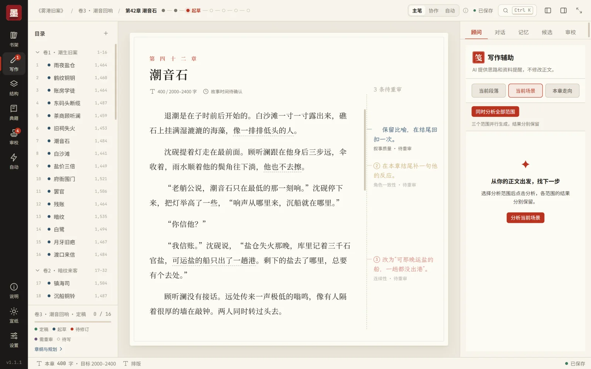

<p align="center">
  
</p>

<p align="center">
  <a href="https://github.com/HannJia/mobish/releases/latest"></a>
  <a href="https://github.com/HannJia/mobish/releases"></a>
  
  <a href="LICENSE"></a>
</p>

<p align="center">
  <a href="https://github.com/HannJia/mobish/releases/latest"><b>下载 Windows 安装包</b></a>
  &nbsp;·&nbsp; <a href="CHANGELOG.md">更新日志</a>
  &nbsp;·&nbsp; <a href="https://github.com/HannJia/mobish/issues">反馈问题</a>
</p>

墨笔生花（mobish）是一款本地优先的 AI 长篇小说写作软件。它把灵感对话、剧情规划、正文编辑、知识库和数值记忆放进同一个写作台：你可以自己主笔，让 AI 在页边提意见；也可以让 AI 按设定和规划起草正文，再由你编辑、审校、决定采纳。

- **AI 只写批注**：审校意见以朱批写在页边，改写和续写放在浮签上，你点“采纳”才进正文。
- **按章节记忆**：典籍逐章记录人物知道什么、关系怎么变、伏笔埋在哪；写第 40 章时，AI 只读到第 40 章。
- **书稿在你手里**：免费、开源、不用注册，作品保存在本机，模型用你自己的 API 密钥。

> [!NOTE]
> 当前版本 **1.1.5**（2026-11-24）。AI 功能需要配置自己的模型服务与额度。作品保存在本机，建议定期使用书架上的“备份项目”。

## 界面一览

<table>
  <tr>
    <td width="50%"><p align="center"><b>写作台</b>：AI 的意见批在页边，改写放在浮签上</p></td>
    <td width="50%"><p align="center"><b>典籍</b>：人物逐章的知情变化，每条都有原文出处</p></td>
  </tr>
  <tr>
    <td><p align="center"><b>结构规划</b>：情节线和伏笔从埋下到回收</p></td>
    <td><p align="center"><b>自动写作</b>：预算、请求上限和检查点</p></td>
  </tr>
  <tr>
    <td><p align="center"><b>书架</b>：多本作品、知识库、备份与导入</p></td>
    <td><p align="center"><b>模型配置</b>：常用服务商预设，按任务分配模型</p></td>
  </tr>
</table>

## 下载安装

1. 打开 [Releases](https://github.com/HannJia/mobish/releases/latest)。
2. 在 Assets 中下载 `mobish-1.1.5.exe`，运行安装向导。
3. 首次打开后进入“设置 → 模型配置”，选择服务商、填写 API 密钥和模型名称，点“测试”确认能连上，再在“任务分配”里分配大纲、写作、审查和对话模型。
4. 回到书架，创建小说，选择写作方式与设定准备方式。

发布的安装包面向 **Windows x64**。普通用户不需要安装 Node.js；GitHub 自动提供的 `Source code` 压缩包是源码，不是安装包。macOS / Linux 暂未提供安装包。

> [!WARNING]
> 安装包尚未进行代码签名，Windows 可能显示未知发布者提示。请核对下载来源与发布页提供的 SHA-256，不要关闭系统安全防护。

> [!IMPORTANT]
> **从 1.0.9 及更早版本升级前请先阅读。** 1.0.10 起使用独立 V3 存储，从旧正式版首次进入时为空书架，需要重新配置模型。旧格式作品和备份不再读取或升级，旧文件保留原处。旧版作品请先在原版本中导出正文并妥善备份。已有原生 V3 数据继续使用原数据目录。

### 1.1.5 更新

- 灵感对话按目录查阅知识库原文，支持多份资料、连续追问和点击引用。配置 BGE-M3 等向量模型可以补充语义检索。
- 创建知识库后直接进入详情，可立即导入资料。知识条目支持标签、按顺序合并和 AI 可见范围。
- 主侧栏新增独立「拆书」，支持从选段分析到全书分析，以及预算、暂停和续跑。作者确认的成果可用于灵感对话、知识库、章纲、写作台和典籍。
- 审校可并排核对相邻章节原句。写作台可从作者选段提炼写法并试写。典籍可区分人物被提及和亲自到场。

### 1.1.4 更新

- 模型测试失败时直接说明原因和解决办法，不再只贴报错原文。
- 作品契约里可以让 AI 推荐书名，点选即可填入。
- 灵感对话标题右侧显示并可直接选择参考知识库；“关于”页可复制诊断信息用于反馈问题。

### 1.1.3 更新

- 新增硅基流动、MiniMax、腾讯混元、OpenRouter，以及本机运行的 Ollama、LM Studio（不需要密钥）；向量模型推荐硅基流动的免费 bge-m3。
- 创建作品时可以先选参考知识库，灵感对话和作品共用；规划页和写作台会提醒超期、久未推进的伏笔。
- 作品可导出为 Word 文档（.docx）；模型不支持某个参数时会自动去掉重试。
- 联网搜索默认不再使用需要境外网络的 Firecrawl；通义、智谱、豆包可直接用自带搜索。

### 1.1.2 更新

- 知识库导入默认“整份导入”：一个文件就是一个条目，不再被切成很多段；也可以选“按标题拆分”，导入前预览拆分结果。
- 支持把文件直接拖进知识库导入，新增 .html 网页文件导入（只读取正文）。
- 知识库页面改为上下排版：上面是条目列表，点击后在下方显示完整内容，带目录可跳转。
- 知识库改为按标题分段检索：写作和对话时只取最相关的几节原文交给 AI，并注明出处，不额外花费。

### 1.1.1 更新

- 添加模型时可选 DeepSeek、通义千问、Kimi、智谱 GLM、豆包、OpenAI、Claude、Gemini 等常用服务商，自动填写官方接口地址；向量模型也有常用服务商可选。
- 联网搜索：支持通义、智谱、Gemini、豆包等模型自带的搜索；没有内置搜索的模型（如 DeepSeek、Kimi）改用独立搜索服务，默认使用无需密钥的免费搜索，也可换成博查、智谱、Tavily 或自建 SearXNG。模型自带的搜索出错时自动改用搜索服务。
- 一个“测试”按钮依次测试对话和联网，哪一步出错就提示哪一步；任务分配列出推荐的模型类型和例子。
- 软件更新窗口的排版和更新内容显示优化；安装程序显示中文名“墨笔生花”。
- 内置写作技能的规则改进，没改过的会自动更新。

已安装的 1.0.10 及以后的版本可从软件内检查更新。1.0.9 及更早版本使用旧安装包识别规则，请从发布页手动下载安装。功能范围、验证与已知问题见 [1.1.5 发布说明](docs/releases/1.1.5.md)，历次更新见 [更新日志](CHANGELOG.md)。

## 写作方式

| 功能 | 主笔 | 协作 | 自动写作 |
| --- | --- | --- | --- |
| 正文创作 | 自己写作，顾问提供思路与资料提醒 | 按章纲或选区生成候选，由作者决定采纳 | 在指定章节范围内生成候选稿，由作者决定采纳 |
| 工作节奏 | 自主编辑 | 按次发起生成与修订 | 设置预算、请求上限与检查点，可暂停、停止和恢复 |
| 故事变化 | 逐条确认候选后写入正式记录 | 相同 | 相同 |
| 审校与定稿 | 全章审校、处理候选、定稿前核对 | 相同 | 候选稿经审校与分析后交作者处理 |
| 知识库与记忆 | 挂载资料，按章节读取人物、事件与设定 | 相同 | 相同 |

新书的写作方式与设定准备方式分别选择。可通过灵感对话、已有大纲、空白或自选设定创建作品。

## 主要功能

### 从灵感到正文

- **书架与项目管理**：多本小说、归档、回收站、项目备份与导入。
- **灵感对话**：讨论故事方向、整理设定，保留最近 5 个创建会话，创建后可在书内查看灵感记录。
- **剧情规划**：管理总纲、分卷规划、章节计划、故事弧线与故事时间线。
- **正文工作台**：目录、稿纸、页边朱批、选区改写候选、历史版本与专注模式。
- **候选与定稿**：故事变化逐条确认后写入正式记录。全章审校显示覆盖与失效原因，定稿前核对保存、故事时间、篇幅、审校、总结和候选处理状态。
- **自动写作**：设置章节范围、篇幅、Token 预算、请求上限与检查点，查看运行账本，暂停、停止或恢复中断任务。
- **模型与规则**：为不同任务分配模型，选择精简 / 均衡 / 严谨工作流，配置可复用的写作技能。
- **联网搜索**：对话可查询网页资料并列出来源，支持模型自带搜索和独立搜索服务。
- **导出**：支持整书 TXT、Word 兼容 HTML（.doc）、EPUB，以及项目备份。灵感记录另可导出 Markdown 或 JSON。

### 知识库与长篇记忆

在书架层面创建资料库，手动录入历史事件、世界观、地点、人物等资料，也可以导入 TXT、Markdown、DOCX、EPUB、文字版和扫描版 PDF。

- 生成条目摘要与知识库摘要，可选**简略 / 标准 / 详细**，由 AI 整理分类。
- 每本小说独立选择是否挂载，以及挂载哪些知识库，两种写作模式均可使用。
- 知识库实体在书架层共享维护：多本书挂载同一个库时，会读取同一份资料，并非每本书复制一份。
- AI 上下文按当前章节组合已确认设定、人物状态、历史事件、相关记忆与挂载资料，并隔离未来章节信息。
- 典籍按章节展示人物知情状态、有向关系、伏笔、时间线与事件因果，保留来源证据和修改历史，并支持全书、分卷与场景回顾。
- 默认提供本地混合检索；可选连接 OpenAI 兼容的 Embedding 服务，补充语义检索。不启用向量服务也能使用写作功能。
- 灵感对话可选择参考哪些书架知识库，默认全部；新小说的挂载范围仍由作者另行确认。书内助手只读取本书挂载的资料。
- 对话中可整理知识条目，点击“存入知识库”预览并编辑，确认后保存到已有库或新建库。助手可回答已接入的软件操作问题。
- PDF 默认直接提取文字层；普通视觉识别开关默认关闭，无文字页面会提示使用本地 OCR。明确开启后才会调用所选图片模型，也可选择整份视觉识别。兼容支持图片输入的 OpenAI 格式聊天接口，沿用现有密钥。
- 本地 OCR 重新读取页面图像并标记疑点，支持指定页码；视觉复核需另行授权，按组发送原图区域并限制请求次数，数字改动和表格歧义保留待确认。
- 识别逐页显示进度，支持暂停。重新打开软件后，选择同一文件和读取方式即可复用本机缓存；文件内容变化后会重新识别。识别结束预览并“确认导入”，可选择自动整理摘要。

单个知识库导入文件上限为 **100 MB**，提取文本最多 500 万字符、PDF 最多 1000 页，压缩文档另有解压安全上限。视觉识别会发送页面图片给所选服务商，可能计费；不保证手写、模糊扫描、复杂排版和数字识别完全准确。摘要和检索也可能遗漏细节，重要设定应保留原始资料并人工核对。

### 故事时间与数据面板

适合需要持续记录状态的种田、修炼、游戏与成长类故事。

| 场景 | 支持的记录方式 |
| --- | --- |
| 时间流逝 | AI 从章节中识别明确经过的天数，推进故事时钟；可人工校正 |
| 作物成长 | 根据故事时间和成长规则计算进度，记录额外进度与剩余成熟时间 |
| 新装备 / 道具 | 从正文提取名称、数值、归属和证据，确认后建立记录 |
| 装备加成 | 区分持有与装备中，只有已装备且明确映射的属性参与计算 |
| 角色属性 | 基础数值与装备后的有效数值分开，卸下装备后重新计算 |

例如，基础攻击力为 100，已装备的武器提供固定攻击力 +20，另一项已装备加成提供基础攻击力 +10%，则有效攻击力为 `100 × 1.1 + 20 = 130`，基础属性仍保留 100。

**提取不等于直接写入。** 点击“完成本章”或“扫描变更”后，AI 产生待确认数据，附带正文证据，确认后才纳入正式记录。仅获得装备不会自动加属性；道具使用也要有明确事实依据。条件触发、最终乘区等复杂规则不属于当前通用自动结算范围。

## 数据、隐私与费用

- **本地保存**：桌面版将小说数据库保存在本机用户数据目录，软件不会上传书稿。
- **AI 请求**：生成、摘要、分析和审查会将对应文本与必要上下文发送到你配置的模型接口；可能产生模型服务费用。
- **联网搜索**：开启“联网”时，问题会作为搜索词发送给所用的搜索服务（模型自带的搜索，或你在“设置 → 联网搜索”里配置的服务），不发送小说正文。
- **扫描 PDF**：本地 OCR 不上传页面；开启普通视觉识别或独立授权疑点复核后才发送对应图片。已完成页文字、坐标及复核记录保存在本机，不缓存密钥或原始页面图片。缓存不随项目备份迁移，清理应用数据会删除缓存；确认导入后的正文条目会进入项目备份。
- **向量服务**：启用远程 Embedding 后，待索引的记忆资料会发送到对应接口。需要本地处理时，应使用自己的本地服务。
- **API Key**：桌面版使用操作系统安全存储加密。本机开发环境为方便调试使用浏览器持久化配置，不适合共享电脑。
- **备份与迁移**：通过“备份项目 / 导入项目”迁移小说与知识库；模型和 API Key 需要在新电脑上重新配置。不要把密钥或私人手稿提交到公开仓库。

联网搜索是独立的可选功能，需要模型接口支持对应搜索协议；关闭搜索并不意味着 AI 对话不联网。

## 软件更新

Windows 安装版支持检查和安装后续更新，1.0.10 起识别 mobish 安装包。“自动更新”默认开启，也可以在“设置 → 关于 → 软件更新”手动检查或关闭。

<details>
<summary>更新机制细节</summary>

- 启动约 12 秒后检查 GitHub 正式版本，持续运行期间每 6 小时再次检查。
- 检查失败后退避重试，恢复联网 / 唤醒后补查；查到新版但更新清单暂时不可用时仍显示提示，不会下载安装未验证文件。
- 开启自动更新时，发现新版并校验更新清单后在后台下载安装包，支持进度显示与取消下载。
- 下载完成后显示“更新已准备好”，点击“安装并重启”并确认后安装。“稍后”可收起提示，设置页仍可安装。
- 安装前先保存当前正文、小说、知识库和模型配置；AI 任务、联网对话、后台任务或项目导入未结束时阻止安装，保存失败也不会继续。
- 检查只访问本仓库的公开版本信息，不上传小说或 API Key；下载校验使用发布清单中的 SHA-512。
- 1.0.0 / 1.0.1 没有更新功能，1.0.9 及更早版本使用旧安装包识别规则，请手动安装最新版本。浏览器和桌面开发环境不会替换本机软件。无法连接 GitHub 或发布文件不完整时，可以打开发布页手动下载。

发布新版本时，除了 `.exe`，还必须上传同次构建的 `latest.yml`，否则软件不能提供一键下载。完整发布步骤见 [更新发布指南](docs/auto-update.md)。

</details>

## 本地开发

技术栈：**Electron + Vue 3 + TypeScript + Pinia + SQL.js / SQLite + Vite**。

<details>
<summary>环境要求与常用命令</summary>

环境要求：Node.js `20.19+`（20.x）或 `22.12+`，以及 npm。此次发布构建使用 Node.js 24。

```bash
git clone https://github.com/HannJia/mobish.git
cd mobish
npm ci
npm run prepare:ocr
```

浏览器调试：

```bash
npm run dev:vite -- --host localhost --port 5173 --strictPort
```

打开 `http://localhost:5173/`。桌面开发使用 `npm run dev`，会启动 Vite 与 Electron。

`localhost` 与 `127.0.0.1` 的浏览器存储相互独立，请固定使用同一地址。清除浏览器数据也会影响本地资料与配置。

| 命令 | 用途 |
| --- | --- |
| `npm run typecheck` | TypeScript 类型检查 |
| `npm run prepare:ocr` | 下载并校验固定版本的本地 OCR 模型；识别时不从外部下载 |
| `npm test` | 自动化测试 |
| `npm run build:renderer` | 仅构建前端，不生成安装包 |
| `npm run build -- --win nsis --x64 --publish never` | 在 Windows 上构建 x64 安装包，不自动发布 |
| `npm run test:electron:packaged` | 检查已打包桌面程序的启动与安全隔离 |
| `npm run test:update-download` | 隔离测试真实更新组件的下载与校验，不安装软件 |
| `node scripts/audit-release.cjs` | 核对安装包内容、更新清单和私有文件排除，生成 SHA-256 校验文件 |

安装包输出到 `release/`。依赖、构建产物、本地数据库与密钥文件不应提交到仓库。本版发布验证状态见 [1.1.5 发布说明](docs/releases/1.1.5.md)。

</details>

## 反馈

通过 [GitHub Issues](https://github.com/HannJia/mobish/issues) 提供软件版本、操作步骤、预期结果和实际结果。截图或日志请先遮盖 API Key、私人文本及其他敏感信息。

本项目面向长篇小说创作，但不承诺百万字上下文一次性读入，也不能替代作者对设定一致性、数值正确性和资料真实性的核查。

## 许可证

墨笔生花以 [MIT 许可证](LICENSE) 开源：可以免费使用、修改和分发，需保留原有的版权与许可声明。

“墨笔生花”“mobish”名称和印章图标不在许可范围内；基于本项目发布修改版时，请换用其他名称和图标。
